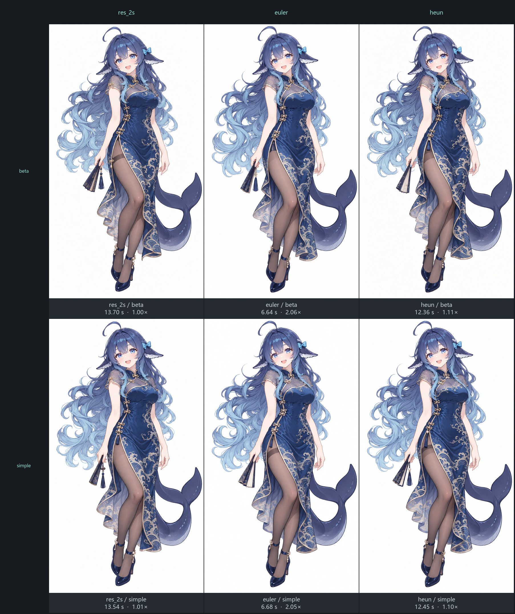

# loulan-xy

用同一模型、条件、Latent 和种子比较 KSampler 的采样器与调度器。一次排队生成一张 XY 总图、每个成功组合的带标签 PNG 和一份耗时表。节点使用 ComfyUI V3 接口，直接读取当前 KSampler 已注册的选项。开发参考版本为 ComfyUI 0.46.0。

## Krea 2 Turbo 实测

用同一个种子比较三种采样器和两种调度器，均为 8 步、CFG 1。横向看同一调度器下的采样差异，纵向看同一采样器换调度器的效果。每格下方标出实际采样时间及相对基准 `res_2s / beta` 的速度。

展开 6 张独立结果，点击可查看原尺寸与耗时

| 调度器 | res_2s | Euler | Heun |
| --- | --- | --- | --- |
| **beta** |  |  |  |
| **simple** |  |  |  |

[可下载的 Krea 2 Turbo 示例工作流](examples/krea-2-turbo-xy.json)使用静物提示词，可替换成自己的测试题材。

## 安装

从仓库的 **Code → Download ZIP** 下载并解压，将包含 `__init__.py` 的目录命名为 `loulan-xy`，放入本机 ComfyUI 的 `custom_nodes/`，重启 ComfyUI 后搜索 `loulan-xy`。

## 从示例开始

将 [Anima 3×2 工作流](examples/loulan-xy-3x2.json) 拖入画布。示例使用 `anima-base-v1.0.safetensors`、`qwen_3_06b_base.safetensors` 和 `qwen_image_vae.safetensors`，以相同的 seed 比较 3 个采样器 × 2 个调度器。点击运行，随后使用执行端的「查看结果」。

按模型选择其他公开示例：[Qwen Image 2.1](examples/qwen-image-2-1-xy.json)、[MOSS Image](examples/moss-image-xy.json)、[Krea 2 Turbo](examples/krea-2-turbo-xy.json)、[Z-Image Turbo](examples/z-image-turbo-xy.json)。将对应 JSON 拖入画布，在加载器里选择已安装的模型权重、文本编码器和 VAE。所有示例都使用中性的静物提示词和同一固定种子。

也可以在节点搜索框输入 `loulan-xy`，把节点接进自己的文生图、图生图工作流。测试单位为一张静态图，使用单帧、batch size 为 1 的 Latent。

| 测试方式 | 连接方法 |
| --- | --- |
| 多种采样器，同一调度器 | 「采样器测试」设为 `test`，勾选采样器，选择固定调度器。 |
| 同一采样器，多种调度器 | 「调度器测试」设为 `test`，勾选调度器，选择固定采样器。 |
| 两轴交叉 | 一端设为 `selection` 并输出列表，连接另一端的相应列表输入。另一端设为 `test`。连接方向可以互换。 |

只在测试端连接 `model`、`positive`、`negative`、`latent`、`vae`。模型的 LoRA、采样模型设置等照常接在上游。每次测试端都按照它的 steps、CFG、denoise 执行。单独通过 SAMPLER/SIGMAS 端口提供的算法，只有同时注册到标准 KSampler 名单时才会出现在选择器里。

## 选择、运行和续跑

- 点 Euler、RES、DPM++ 等家族按钮会替换当前勾选，之后可打开「勾选」搜索、增减。全选和清空分别针对当前轴。组合数随两个节点的有效选择变化。
- 运行时，普通矩阵按采样器分列、调度器分行。每一格从相同的原始 Latent 和 seed 生成起始噪声。底栏记录采样器、调度器、采样秒数。计时覆盖设备同步后的原生采样调用，VAE 解码、绘图和写盘另行处理。首格可能包含模型载入，算法自身的随机步骤也会影响画面。
- 打开「加入基准组合」并选择基准采样器、调度器。每个种子都有对应的基准时间，清单记录相对耗时和相对速度。若算法主要使用噪声序列端点（如 dpm_fast、dpm_adaptive），不同调度器可能产生很接近的结果。
- 默认每次排队都实际采样。要补图，沿用相同的测试名称和采样设置，打开「续跑同配置 / 只补缺图」。程序检查源输入签名及已保存单图的完整性，复用完整 PNG，重新计算缺失、损坏和失败的格子。中断时保留已经保存的单图。更换模型、输入或组合计划后会创建相应的新测试。
- 一般组合错误会在整图和 CSV 中保留位置与原因。中断、磁盘错误或显存不足会停止这轮任务，可处理原因后继续。大矩阵总图自动缩小格子，独立 PNG 保留生成尺寸并在下方另加信息栏。

## 收藏、细节与复测

1. 从执行端打开「查看结果」，在满意的组合上点收藏。
2. 需要检查细节时指定 A 和 B，用滑杆对比。框出一处细节，导出局部总图，所有格子都会使用同一相对位置。也可调整格子尺寸或交换横纵轴，直接重排已有图片。
3. 在结果页填入复测种子，发送给打开它的节点；独立窗口可以复制配置并在节点的选择面板内粘贴。回到画布检查组数，再点运行。收藏按**确切配对**测试，例如 3 个收藏 × 4 个种子产生 12 张图。复测矩阵按配对分列、种子分行。
4. 点击节点上的「退出收藏复测」即可恢复普通 XY 选择。再次排队之前可查看组合数。

## 输出

每轮使用 ComfyUI 输出目录下的独立子目录 `loulan-xy/<测试ID>/`。

| 内容 | 用途 |
| --- | --- |
| `grid.png` | 当轮完整 XY 总图，同时从节点的 IMAGE 端口输出 |
| `images/` | 原分辨率带信息栏的单图，文件名包含行列号、采样器、调度器与种子 |
| `results.csv` | 各格的采样秒数、基准比值、状态、图像尺寸、文件名和错误信息 |
| `manifest.json` | 保存本轮计划、实际进度和文件校验信息，供查看与续跑使用 |
| `favorites.json`、`derived/` | 使用收藏、局部裁切或重排后生成的文件 |

迁移到其他安装时，将整个 `loulan-xy` 目录放入该实例的 `custom_nodes` 后重启。使用实例已有的 ComfyUI、PyTorch、NumPy、Pillow 和 aiohttp。

## 分享生成结果

ComfyUI 默认会把提示词和工作流写入生成的 PNG。若准备公开样图，可在生成时使用 ComfyUI 的 `--disable-metadata`。分享 CSV 或错误清单前，请检查其中的文件名和报错内容。结果查看器使用当前 ComfyUI 实例的输出目录；能够访问同一实例的人也可以浏览该目录里的 XY 测试。
